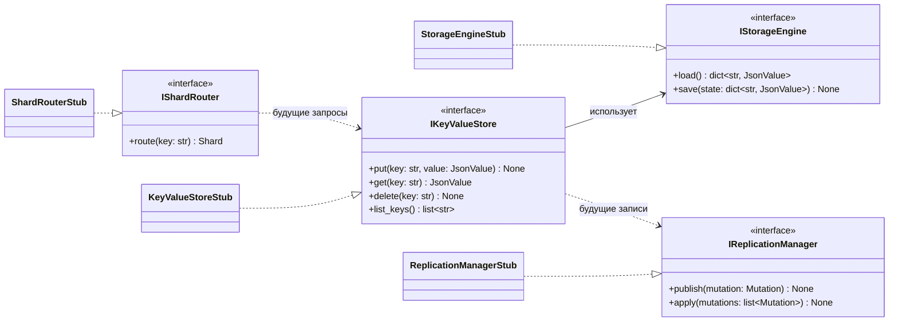

# Диаграмма компонентов лабораторной работы № 1

Сплошная зависимость показывает единственное действующее направление между
контрактами первой лабораторной работы. Пунктирные зависимости зарезервированы
для последующих этапов и пока не имеют реализации.

