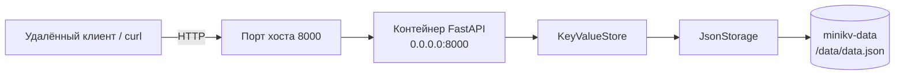

# Развёртывание MiniKV в лабораторной работе № 3

Compose публикует порт контейнера через `${MINIKV_PORT:-8000}` и монтирует
именованный том `minikv-data` в `/data`. Пересоздание контейнера не удаляет том,
поэтому новый экземпляр приложения загружает ранее сохранённый JSON-файл.
