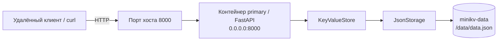

# Развёртывание MiniKV в лабораторной работе № 3

Compose публикует порт контейнера `primary` через `${MINIKV_PORT:-8000}` и
монтирует именованный том `minikv-data` в `/data`. Имя тома сохранено после
добавления репликации, поэтому данные односервисного развёртывания третьей
лабораторной работы остаются доступны основному узлу. Пересоздание контейнера
не удаляет том, и новый экземпляр приложения загружает сохранённый JSON-файл.
