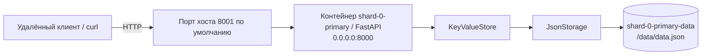

# Развёртывание MiniKV в лабораторной работе № 3

Compose публикует порт контейнера `shard-0-primary` через
`${MINIKV_SHARD_0_PRIMARY_PORT:-8001}` и монтирует именованный том
`shard-0-primary-data` в `/data`. Запуск только этого сервиса воспроизводит
односервисное развёртывание третьей лабораторной работы. Пересоздание контейнера
не удаляет том, и новый экземпляр приложения загружает сохранённый JSON-файл.
