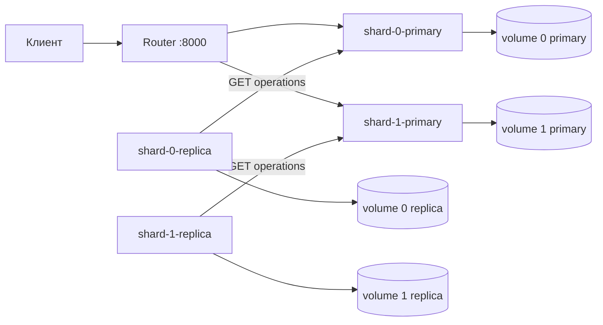

# Архитектура Lab 5

Router не хранит значения и не участвует в репликации. Для каждой операции с
ключом он вычисляет целое значение SHA-256 от полного UTF-8 представления и
выбирает индекс `digest % 2`. Реплики опрашивают только primary своего
сегмента, поэтому журналы и sequence-пространства независимы.
