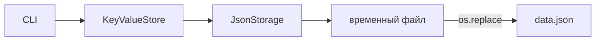

# Лабораторная работа № 2 - локальная база данных

## 1. Цель

Реализовать контракты первой лабораторной работы и получить локальную базу
MiniKV, состояние которой сохраняется между запусками процессов. Файл данных не
должен повреждаться при незавершённой или неуспешной записи.

## 2. Что реализовано

- `JsonStorage` загружает один JSON-объект из UTF-8 файла;
- отсутствие файла трактуется как новая пустая база, а повреждённый или
  недоступный файл приводит к `PersistenceError`;
- сохранение выполняется через временный файл в том же каталоге, `flush`,
  `fsync` и атомарную замену;
- `KeyValueStore` реализует `put`, `get`, `delete` и сортированный `list_keys`;
- ключи и строгие JSON-значения проверяются до изменения состояния;
- изменяемые значения копируются на границе хранилища, поэтому вызывающая
  сторона не получает ссылку на внутреннее состояние;
- добавлены CLI, автоматические тесты, демонстрационный сценарий и пример
  файла данных.

## 3. Архитектура и поток сохранения



Хранилище сначала формирует новое состояние отдельно от текущего. Только после
успешного сохранения эта копия становится активной в памяти. Если запись или
атомарная замена завершается ошибкой, прежние данные остаются одновременно в
памяти и в последнем корректном файле.

## 4. Как запустить

Создать или заменить значение:

```bash
uv run minikv --database-file data/data.json put profile \
  '{"name":"Ирина","active":true}'
```

Прочитать значение, перечислить ключи и удалить запись:

```bash
uv run minikv --database-file data/data.json get profile
uv run minikv --database-file data/data.json list
uv run minikv --database-file data/data.json delete profile
```

Полная изолированная демонстрация всех операций и загрузки из нового процесса:

```powershell
.\scripts\demo_local.ps1
```

CLI печатает значения и списки в JSON. Известная ошибка выводится в `stderr`
без трассировки, а процесс возвращает ненулевой код.

## 5. Как проверить

После разрешения на запуск тестов следует выполнить:

```bash
uv run pytest tests/test_interfaces.py tests/test_storage.py
```

Набор проверяет создание и перезапись данных, чтение, удаление, сортировку,
повторный запуск, копирование изменяемых значений, повреждённый JSON, неверные
значения и сохранность последнего файла при имитации сбоя атомарной замены.

Тесты и демонстрационный сценарий в текущей рабочей сессии не запускались,
поскольку отдельное разрешение пользователя на тестовый запуск не получено.
Фактический вывод необходимо добавить в этот раздел после выполнения команд.

## 6. Вывод и ограничения

MiniKV выполняет четыре локальные операции и сохраняет успешные изменения в
одном JSON-файле между процессами. На этом этапе нет конкурентной блокировки,
транзакций, сетевого API, репликации и шардинга; эти возможности относятся к
следующим лабораторным работам.
