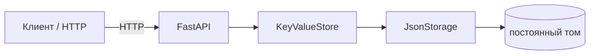

# Лабораторная работа № 3 - REST API и контейнерное развёртывание

## 1. Цель

Предоставить одну постоянную базу MiniKV как сетевой сервис с REST API.
Упаковать сервис в непривилегированный Docker-контейнер и сохранять данные в
именованном томе между пересозданиями контейнера.

## 2. Что реализовано

- приложение FastAPI создаёт один `KeyValueStore` над `JsonStorage`;
- путь к файлу задаётся через `MINIKV_DATA_FILE`;
- реализованы `PUT`, `GET`, `DELETE`, список ключей и проверка готовности;
- доменные ошибки централизованно преобразуются в HTTP 404, 422, 500 и 503;
- ответы при внутренних ошибках не раскрывают пути, трассировки или секреты;
- зависимость хранилища заменяется через механизм FastAPI dependency overrides;
- добавлены интеграционные тесты без внешнего сервера;
- Docker Compose публикует настраиваемый порт и подключает постоянный том;
- `scripts/demo_api.sh` и `scripts/demo_api.ps1` выполняют повторяемый сценарий
  с изолированным ключом в Bash и PowerShell соответственно.

## 3. Архитектура



Endpoint не реализуют хранение самостоятельно: каждый запрос делегируется
контракту `IKeyValueStore`. Подробная схема развёртывания находится в
`docs/diagrams/lab3_deployment.md`.

## 4. HTTP-контракт

| Метод | Путь | Успешный ответ |
| --- | --- | --- |
| `PUT` | `/kv/{key}` | `204 No Content` |
| `GET` | `/kv/{key}` | `200 {"value": ...}` |
| `DELETE` | `/kv/{key}` | `204 No Content` |
| `GET` | `/kv` | `200 {"keys": [...]}` |
| `GET` | `/health` | `200 {"status": "ok"}` |

Отсутствующий ключ возвращает HTTP 404, неверный запрос - HTTP 422, ошибка
постоянного хранилища - HTTP 500, а недоступное хранилище в `/health` - HTTP
503. Интерактивная документация доступна по адресу
`http://localhost:<MINIKV_PORT>/docs`, где `<MINIKV_PORT>` - фактически
настроенный порт.

## 5. Как запустить

Локальный сервер в PowerShell или Bash загружает настройки непосредственно из
`.env`:

```bash
uv run --env-file .env minikv-api
```

`MINIKV_DATA_FILE` задаёт локальный JSON-файл, а `MINIKV_PORT` - порт
локального HTTP-сервера. Значения по умолчанию остаются
`data/data.json` и `8000`.

Контейнерный сервис автоматически читает `MINIKV_PORT` из корневого файла
`.env`. Внутри контейнера база всегда хранится в `/data/data.json`, чтобы
локальный путь из `MINIKV_DATA_FILE` не отключал именованный том:

```bash
docker compose up --build -d
docker compose ps
```

Для изменения опубликованного порта достаточно изменить `MINIKV_PORT` в
`.env` и повторно выполнить `docker compose up -d`.

## 6. Примеры запросов

```powershell
$port = uv run --env-file .env python -c `
    "import os; print(os.getenv('MINIKV_PORT', '8000'))"
$baseUrl = "http://localhost:$port"

$json = @{
    value = @{ name = "Ирина"; active = $true }
} | ConvertTo-Json -Compress
$body = [System.Text.Encoding]::UTF8.GetBytes($json)

Invoke-RestMethod `
    -Method Put `
    -Uri "$baseUrl/kv/profile" `
    -ContentType "application/json; charset=utf-8" `
    -Body $body

$response = Invoke-WebRequest -UseBasicParsing "$baseUrl/kv/profile"
[System.Text.Encoding]::UTF8.GetString(
    $response.RawContentStream.ToArray()
)
# {"value":{"name":"Ирина","active":true}}

$response = Invoke-WebRequest -UseBasicParsing "$baseUrl/kv"
[System.Text.Encoding]::UTF8.GetString(
    $response.RawContentStream.ToArray()
)
# {"keys":["profile"]}
```

Полный повторяемый сценарий:

```powershell
.\scripts\demo_api.ps1
```

## 7. Проверка сохранности данных

Записать контрольное значение и пересоздать только контейнер, не удаляя том:

```powershell
$port = uv run --env-file .env python -c `
    "import os; print(os.getenv('MINIKV_PORT', '8000'))"
$baseUrl = "http://localhost:$port"

$json = @{ value = "survives-recreate" } | ConvertTo-Json -Compress
$body = [System.Text.Encoding]::UTF8.GetBytes($json)
Invoke-RestMethod `
    -Method Put `
    -Uri "$baseUrl/kv/persistence-check" `
    -ContentType "application/json; charset=utf-8" `
    -Body $body

docker compose up --build -d --force-recreate

$response = Invoke-WebRequest -UseBasicParsing `
    "$baseUrl/kv/persistence-check"
[System.Text.Encoding]::UTF8.GetString(
    $response.RawContentStream.ToArray()
)
# {"value":"survives-recreate"}
```

## 8. Автоматическая проверка

Тесты проверяют создание, замену, чтение, удаление, список, отсутствующие ключи,
валидацию запроса, готовность, безопасные ошибки и сохранность данных после
пересоздания приложения.

```bash
uv run pytest tests/test_interfaces.py tests/test_storage.py tests/test_api.py
```

## 9. Вывод и ограничения

MiniKV доступна по HTTP и сохраняет данные вне жизненного цикла контейнера.
Локальный CLI предыдущей работы остаётся доступен. На этом этапе нет
конкурентной координации нескольких процессов, репликации, автоматического
переключения узлов и шардинга; публичный контракт `/kv` подготовлен для
сохранения в следующих лабораторных работах.
