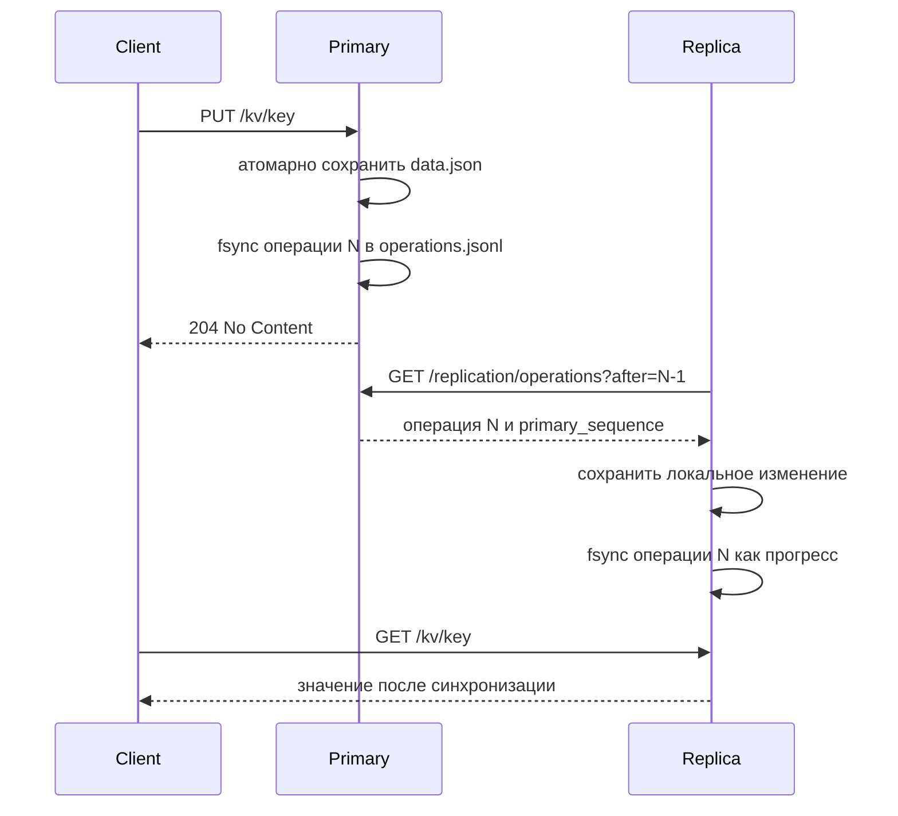

# Лабораторная работа № 4 - primary-replica репликация

## 1. Цель

Расширить сетевую MiniKV парой из основного узла и реплики только для чтения.
Изменения передаются асинхронно в исходном порядке, а временно остановленная
реплика продолжает работу с последнего устойчиво применённого номера.

## 2. Что реализовано

- роль узла задаётся через `MINIKV_NODE_ROLE=primary|replica`;
- primary сохраняет успешные `put` и `delete` в журнал JSON Lines с возрастающим номером;
- реплика периодически (`DEFAULT_REPLICATION_POLL_INTERVAL = 1.0` - раз в 1 секунду) запрашивает ограниченные пачки через `GET /replication/operations?after=N`;
- локальный журнал реплики одновременно хранит устойчивый прогресс и позволяет обнаружить конфликт повторной операции;
- повторное применение совпадающей операции безопасно, удаление уже отсутствующего ключа при воспроизведении считается успешным;
- разрыв или конфликт последовательности останавливает применение текущей пачки и отражается в статусе;
- публичные `PUT` и `DELETE` на обычной реплике возвращают HTTP 403;
- после `MINIKV_FAILOVER_TIMEOUT` недоступности primary реплика временно
  повышается, принимает записи и публикует собственное продолжение журнала;
- восстановленный предпочтительный primary запрашивает атомарный failback,
  применяет операции периода сбоя и только затем становится writable;
- `GET /replication/status` сообщает роль, локальный и известный primary sequence, lag, время синхронизации и безопасную ошибку;
- фоновая задача запускается и завершается через lifespan FastAPI;
- в итоговой Compose-топологии Lab 4 представлена парой `shard-0-primary` и
  `shard-0-replica` с независимыми томами.

## 3. Архитектура и алгоритм



Внутри одного процесса primary изменение данных и запись журнала защищены одним lock, поэтому параллельные запросы получают детерминированный порядок. Выбран порядок «сначала локальные данные, затем журнал»: HTTP 204 возвращается только после устойчивой записи обоих файлов. Если запись журнала завершается ошибкой, клиент получает HTTP 500, хотя локальный файл данных уже мог измениться; межфайловая транзакция в учебной реализации отсутствует.

Подробная схема находится в `docs/diagrams/lab4_replication.md`.

## 4. Конфигурация

| Переменная | Назначение | Значение по умолчанию |
| --- | --- | --- |
| `MINIKV_DATA_FILE` | локальный JSON-файл данных | `data/data.json` |
| `MINIKV_NODE_ROLE` | `primary` или `replica` | `primary` |
| `MINIKV_REPLICATION_LOG` | локальный JSONL-журнал | рядом с data-файлом |
| `MINIKV_PRIMARY_URL` | URL primary, обязательный для replica | отсутствует |
| `MINIKV_REPLICATION_POLL_INTERVAL` | период опроса в секундах | `1.0` |
| `MINIKV_REPLICATION_BATCH_SIZE` | максимальная пачка primary | `100` |
| `MINIKV_REPLICATION_REQUEST_TIMEOUT` | HTTP-тайм-аут в секундах | `5.0` |
| `MINIKV_AUTOMATIC_FAILOVER` | включить promotion и failback | `false` |
| `MINIKV_FAILOVER_TIMEOUT` | недоступность до promotion, секунды | `5.0` |
| `MINIKV_PEER_URL` | адрес второго узла пары | отсутствует |

Приложение отклоняет неизвестную роль, неположительные интервалы и тайм-ауты, пустую пачку, совпадающие пути data/log, replica без корректного primary URL и primary с лишним primary URL.

## 5. Как запустить

```bash
docker compose up --build -d shard-0-primary shard-0-replica
docker compose ps shard-0-primary shard-0-replica
```

Адреса по умолчанию:

- primary: `http://localhost:8001`;
- replica: `http://localhost:8002`.

Порты можно изменить через `MINIKV_SHARD_0_PRIMARY_PORT` и
`MINIKV_SHARD_0_REPLICA_PORT`.

## 6. Демонстрация

```powershell
.\scripts\demo_replication.ps1
.\scripts\demo_failover.ps1
```

Сценарий записывает значение в `shard-0-primary`, ждёт
`shard-0-replica`, останавливает реплику, выполняет новые операции, снова
запускает контейнер и ждёт `lag = 0` вместо фиксированной долгой задержки.

## 7. Проверка

Тестовые сценарии находятся в `tests/test_replication.py` и покрывают порядок журнала, восстановление sequence, HTTP 403, идемпотентность, разрывы, конфликты, ограниченные пачки и догоняющую синхронизацию.

С разрешения пользователя полный накопительный набор запускается так:

```bash
uv run pytest tests/test_interfaces.py tests/test_storage.py tests/test_api.py tests/test_replication.py
```

Результат `27 passed` от 27 октября 2026 года относится к состоянию до
добавления автоматического failover. Для новой реализации добавлены сценарии
promotion, замораживания временного primary, передачи хвоста журнала и выбора
активного узла router. Актуальный запуск выполняется командами из раздела выше
и демонстрационным скриптом `scripts/demo_failover.ps1`.

## 8. Вывод и ограничения

MiniKV реализует eventual consistency и автоматическое переключение внутри фиксированной пары. Это учебная схема без quorum и внешнего координатора: при сетевом разделении возможен split-brain. Безопасный автоматический failback предполагает общий непротиворечивый префикс журналов; перед демонстрационным отключением реплика должна иметь `lag = 0`. TLS, аутентификация внутренних endpoint, compaction, начальный snapshot и транзакция между data-файлом и журналом не реализованы.

## 9. Скрипты для проверки

Оба скрипта демонстрируют отказоустойчивость MiniKV, но на разных уровнях:

- `demo_replication.ps1` проверяет репликацию данных и догоняющую синхронизацию после простоя реплики.
- `demo_failover.ps1` проверяет полноценное переключение ролей: promotion реплики, работу через router и последующий failback.

### `demo_replication.ps1`

Скрипт: [demo_replication.ps1](C:/Users/krish/VSProjects/ITMO_SECS_BDI_2026/scripts/demo_replication.ps1)

#### 1. Получение параметров

Скрипт принимает:

- URL primary и replica - явно либо из `PRIMARY_URL` и `REPLICA_URL`;
- имена Docker Compose-сервисов;
- ключ для демонстрации.

По умолчанию используются сервисы:

- `shard-0-primary`;
- `shard-0-replica`.

#### 2. Включение строгой обработки ошибок

```powershell
$ErrorActionPreference = "Stop"
```

Ошибки PowerShell-команд становятся останавливающими. Если HTTP-запрос или другая операция завершается ошибкой, выполнение прерывается, кроме участков с явным `try/catch`.

#### 3. Определение адресов узлов

Функция `Get-ComposeUrl` вызывает:

```powershell
docker compose port <service> 8000
```

Она узнаёт, на какой порт хоста опубликован внутренний порт `8000` контейнера.

Если определить порт не удалось, используются резервные значения:

- primary - переменная `MINIKV_SHARD_0_PRIMARY_PORT` или порт `8001`;
- replica - `MINIKV_SHARD_0_REPLICA_PORT` или порт `8002`.

#### 4. Генерация уникального ключа

Если `DemoKey` не передан, создаётся ключ вида:

```text
lab4-demo-<Unix timestamp>-<PID>
```

Добавление PID уменьшает вероятность совпадения ключей при одновременном запуске нескольких сценариев.

#### 5. Подготовка ожидания репликации

Функция `Wait-ReplicationSequence` до 30 раз, раз в секунду, запрашивает:

```text
GET /replication/status
```

Реплика считается синхронизированной, когда одновременно выполнены условия:

- `current_sequence` равен ожидаемому номеру операции;
- `lag` равен `0`;
- `healthy` имеет истинное значение.

Временные ошибки подключения игнорируются, поскольку контейнер может ещё запускаться. Через 30 секунд функция выбрасывает ошибку.

#### 6. Запись первого значения на primary

На primary напрямую отправляется:

```text
PUT /kv/<DemoKey>
```

со значением:

```json
{"value":{"stage":1}}
```

Router здесь не используется - запрос направлен непосредственно на primary выбранного шарда.

#### 7. Проверка обычной репликации

Скрипт:

1. Получает `current_sequence` primary.
2. Ждёт, пока replica достигнет той же последовательности.
3. Читает ключ непосредственно с replica.
4. Выводит полученное значение в компактном JSON.

Таким образом подтверждается, что запись `stage = 1` была передана реплике.

#### 8. Имитация недоступности реплики

Выполняется:

```powershell
docker compose stop shard-0-replica
```

Код возврата Docker проверяется явно. При ошибке сценарий прекращается.

#### 9. Изменение данных во время простоя реплики

Пока replica остановлена, на primary выполняются две операции:

1. Значение ключа обновляется до `stage = 2`.
2. Этот же ключ удаляется.

Реплика пропускает обе операции, поскольку в этот момент выключена.

#### 10. Возвращение реплики

Реплика запускается командой:

```powershell
docker compose start shard-0-replica
```

После этого скрипт снова получает актуальный `current_sequence` primary и ждёт, пока replica его достигнет.

Это проверяет догоняющую синхронизацию: реплика должна получить все пропущенные изменения журнала.

#### 11. Проверка репликации удаления

Скрипт пытается прочитать удалённый ключ с replica.

Корректным результатом считается только HTTP `404`. Если ключ существует или сервер возвращает другой статус, сценарий завершается ошибкой.

Это доказывает, что на replica перенеслась не только промежуточная запись `stage = 2`, но и последующее удаление.

#### 12. Завершение

В конце выводятся:

- текущий `/replication/status` реплики;
- сообщение об успешном завершении сценария восстановления.

---

### `demo_failover.ps1`

Скрипт: [demo_failover.ps1](C:/Users/krish/VSProjects/ITMO_SECS_BDI_2026/scripts/demo_failover.ps1)

#### 1. Настройка адресов

В отличие от первого скрипта, адреса здесь зафиксированы:

- router - `http://localhost:8000`;
- primary - `http://localhost:8001`;
- replica - `http://localhost:8002`.

Используются два ключа:

- `alpha` - основной ключ;
- `ключ` - временный ключ для проверки удаления.

Оба пропускаются через `EscapeDataString`, чтобы безопасно использовать их внутри URL. Это особенно важно для кириллического ключа.

#### 2. Функция ожидания условия

`Wait-Condition` принимает:

- блок проверочного кода;
- текстовое описание;
- тайм-аут, по умолчанию 45 секунд.

Каждые 500 мс функция выполняет условие. Временные ошибки HTTP игнорируются, поскольку во время переключения узлы могут быть недоступны.

При успехе выводится:

```text
[OK] <описание>
```

Если условие не выполнено за отведённое время, сценарий завершается ошибкой.

#### 3. Запуск всей топологии

Выполняется:

```powershell
docker compose up --build -d
```

То есть образы собираются, а контейнеры запускаются в фоновом режиме.

В этом скрипте код возврата Docker отдельно не проверяется, но последующие проверки состояния обычно обнаружат проблему по тайм-ауту.

#### 4. Проверка исходной роли

Скрипт ждёт, пока узел на порту `8001` сообщит:

```json
{"role":"primary"}
```

То есть сначала подтверждается нормальная исходная топология.

#### 5. Создание исходной записи через router

Через публичный router выполняется запись ключа `alpha`:

```json
{"value":{"stage":"before-failover"}}
```

После этого скрипт ждёт, пока `lag` реплики станет равен нулю. Значит, исходная запись успела попасть на replica до отключения primary.

#### 6. Имитация отказа primary

Останавливается сервис:

```powershell
docker compose stop shard-0-primary
```

После этого скрипт ждёт, пока бывшая replica сообщит:

- `role == "primary"`;
- `promoted == true`.

Это подтверждает автоматическое повышение реплики до primary.

#### 7. Проверка записи во время failover

Через router значение `alpha` меняется на:

```json
{"value":{"stage":"during-failover"}}
```

Router должен самостоятельно направить запрос на повышенную реплику, поскольку исходный primary выключен.

Затем выполняется `GET`, и поле `stage` проверяется явно. Ожидается `during-failover`.

#### 8. Проверка удаления

Через router:

1. Создаётся ключ `ключ` со значением `"temporary"`.
2. Ключ удаляется.
3. Выполняется попытка чтения.

Корректным результатом считается HTTP `404`.

Таким образом во время failover проверяются `PUT`, `GET` и `DELETE`.

#### 9. Проверка списка ключей

Запрашивается:

```text
GET /kv
```

Проверяется, что:

- `alpha` присутствует;
- удалённый ключ `ключ` отсутствует.

Это проверяет ручку получения списка ключей после операций на повышенном узле.

#### 10. Проверка маршрутизации по шардам

Запрашивается:

```text
GET /shards/alpha
```

Ожидается:

```json
{"shard":"shard-0"}
```

То есть диагностическая логика router должна отнести основной ключ к правильному сегменту.

#### 11. Проверка состояния router

Запрашивается:

```text
GET /health
```

Ожидается `status == "ok"`. Это подтверждает, что router остаётся работоспособным при недоступности исходного primary.

#### 12. Возвращение исходного primary

Остановленный сервис запускается:

```powershell
docker compose start shard-0-primary
```

После этого скрипт ждёт восстановления исходной топологии:

- исходный узел снова имеет роль `primary`;
- у него `preferred_primary == true`;
- временно повышенный узел снова имеет роль `replica`;
- у него `promoted == false`;
- `current_sequence` обоих узлов совпадает.

Это одновременно проверяет синхронизацию журналов и автоматический failback.

#### 13. Проверка сохранности записи периода failover

Через router снова читается `alpha`.

Ожидается значение:

```text
during-failover
```

Следовательно, запись, сделанная на временном primary, должна быть перенесена на восстановленный предпочтительный primary.

#### 14. Завершение

Если все проверки прошли, выводится:

```text
[OK] Автоматические promotion и failback завершены корректно.
```

Итоговая последовательность второго сценария выглядит так:

```text
Запуск топологии
→ запись на исходный primary
→ синхронизация replica
→ остановка primary
→ promotion replica
→ CRUD через router
→ запуск исходного primary
→ синхронизация журналов
→ возврат исходных ролей
→ проверка сохранности данных
```