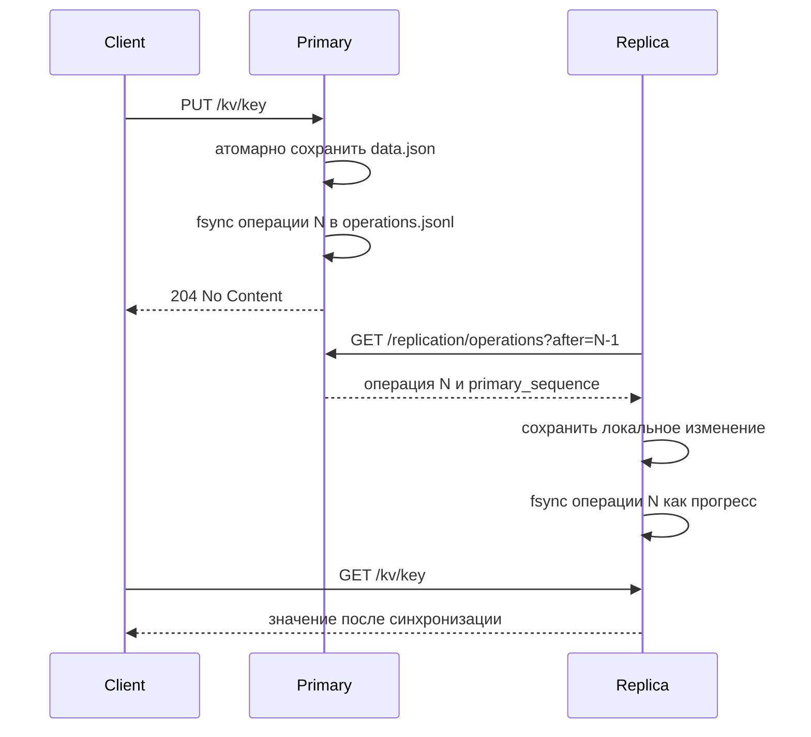

# Лабораторная работа № 4 - primary-replica репликация

## 1. Цель

Расширить сетевую MiniKV одним основным узлом и двумя репликами только для чтения. Изменения передаются асинхронно в исходном порядке, а временно остановленная реплика продолжает работу с последнего устойчиво применённого номера.

## 2. Что реализовано

- роль узла задаётся через `MINIKV_NODE_ROLE=primary|replica`;
- primary сохраняет успешные `put` и `delete` в журнал JSON Lines с возрастающим номером;
- реплика периодически запрашивает ограниченные пачки через `GET /replication/operations?after=N`;
- локальный журнал реплики одновременно хранит устойчивый прогресс и позволяет обнаружить конфликт повторной операции;
- повторное применение совпадающей операции безопасно, удаление уже отсутствующего ключа при воспроизведении считается успешным;
- разрыв или конфликт последовательности останавливает применение текущей пачки и отражается в статусе;
- публичные `PUT` и `DELETE` на реплике возвращают HTTP 403;
- `GET /replication/status` сообщает роль, локальный и известный primary sequence, lag, время синхронизации и безопасную ошибку;
- фоновая задача запускается и завершается через lifespan FastAPI;
- Docker Compose создаёт один primary и две реплики с независимыми томами.

## 3. Архитектура и алгоритм



Внутри одного процесса primary изменение данных и запись журнала защищены одним lock, поэтому параллельные запросы получают детерминированный порядок. Выбран порядок «сначала локальные данные, затем журнал»: HTTP 204 возвращается только после устойчивой записи обоих файлов. Если запись журнала завершается ошибкой, клиент получает HTTP 500, хотя локальный файл данных уже мог измениться; межфайловая транзакция в учебной реализации отсутствует.

Подробная схема находится в `docs/diagrams/lab4_replication.md`.

## 4. Конфигурация

| Переменная | Назначение | Значение по умолчанию |
| --- | --- | --- |
| `MINIKV_DATA_FILE` | локальный JSON-файл данных | `data/data.json` |
| `MINIKV_NODE_ROLE` | `primary` или `replica` | `primary` |
| `MINIKV_REPLICATION_LOG` | локальный JSONL-журнал | рядом с data-файлом |
| `MINIKV_PRIMARY_URL` | URL primary, обязательный для replica | отсутствует |
| `MINIKV_REPLICATION_POLL_INTERVAL` | период опроса в секундах | `1.0` |
| `MINIKV_REPLICATION_BATCH_SIZE` | максимальная пачка primary | `100` |
| `MINIKV_REPLICATION_REQUEST_TIMEOUT` | HTTP-тайм-аут в секундах | `5.0` |

Приложение отклоняет неизвестную роль, неположительные интервалы и тайм-ауты, пустую пачку, совпадающие пути data/log, replica без корректного primary URL и primary с лишним primary URL.

## 5. Как запустить

```bash
docker compose up --build -d
docker compose ps
```

Адреса по умолчанию:

- primary: `http://localhost:8000`;
- replica-1: `http://localhost:8001`;
- replica-2: `http://localhost:8002`.

Порты можно изменить через `MINIKV_PORT`, `MINIKV_REPLICA_1_PORT` и `MINIKV_REPLICA_2_PORT`.

## 6. Демонстрация

Bash:

```bash
bash scripts/demo_replication.sh
```

PowerShell:

```powershell
.\scripts\demo_replication.ps1
```

Сценарий записывает значение на primary, ждёт обе реплики, останавливает `replica-2`, выполняет новые операции, запускает контейнер и ждёт `lag = 0` вместо фиксированной долгой задержки.

## 7. Проверка

Тестовые сценарии находятся в `tests/test_replication.py` и покрывают порядок журнала, восстановление sequence, HTTP 403, идемпотентность, разрывы, конфликты, ограниченные пачки и догоняющую синхронизацию.

С разрешения пользователя полный накопительный набор запускается так:

```bash
uv run pytest tests/test_interfaces.py tests/test_storage.py tests/test_api.py tests/test_replication.py
```

Полученный результат полного запуска 27 октября 2026 года:

```text
27 passed, 1 warning in 1.78s
```

Предупреждение `StarletteDeprecationWarning` относится к совместимости `TestClient` установленной версии FastAPI с `httpx` и не влияет на результат проверок. Дополнительно выполнены проверки `uv run python -m compileall src tests` и `docker compose config --quiet`. Демонстрационный сценарий также успешно выполнен 27 октября 2026 года с primary, опубликованным на порту 8080: обе реплики получили начальное значение, остановленная `replica-2` после запуска достигла `current_sequence = 3`, `lag = 0`, `healthy = true`.

## 8. Вывод и ограничения

MiniKV реализует eventual consistency: сразу после ответа primary реплика может временно вернуть старое значение. Автоматическое переключение primary, выбор лидера, quorum-записи, TLS, аутентификация внутреннего endpoint, compaction журнала, начальный snapshot уже существующей базы и транзакция между data-файлом и журналом не реализованы. Реплика не сбрасывает данные и прогресс при временной недоступности primary и продолжает синхронизацию после восстановления.
