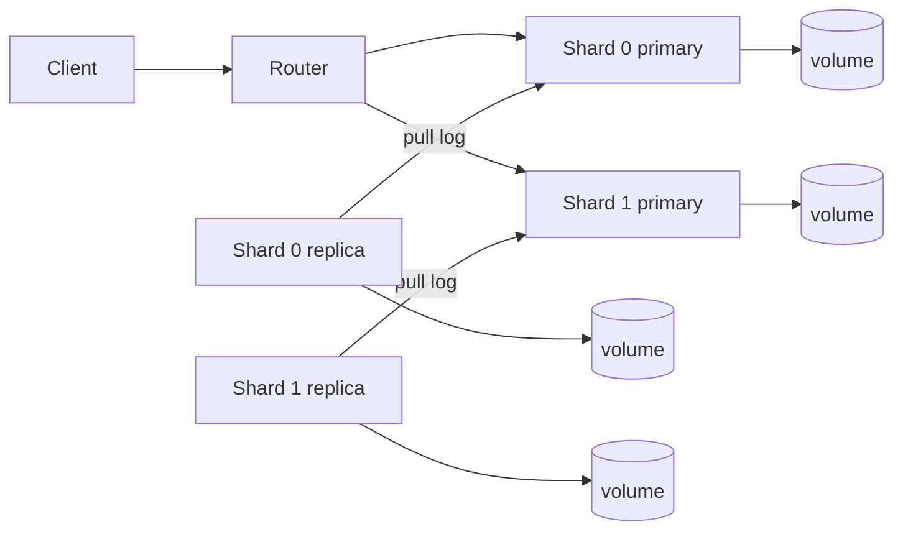

# Лабораторная работа № 5 - шардирование с репликацией

## 1. Цель

Объединить две независимые реплицируемые пары MiniKV за единым REST-адресом.
Ключи должны стабильно распределяться между двумя сегментами, а репликация
должна продолжать работать независимо внутри каждого сегмента.

## 2. Что реализовано

- `ShardRouter` реализует `IShardRouter` и выбирает сегмент по формуле
  `int(SHA256(key.encode("utf-8"))) % 2`;
- конфигурация требует ровно два уникальных идентификатора и два корректных
  уникальных HTTP URL primary;
- тайм-аут обращения должен быть конечным и положительным;
- `PUT`, `GET` и `DELETE /kv/{key}` отправляются ровно в один primary;
- изменения не повторяются после неоднозначного сетевого сбоя;
- `GET /kv` возвращает отсортированное объединение без дубликатов и полностью
  завершается ошибкой HTTP 503, если недоступен хотя бы один сегмент;
- `GET /shards/{key}` локально возвращает только идентификатор сегмента;
- router сохраняет публичные ответы Lab 3: 204, 404, 422, 500 и безопасный 503;
- Compose содержит router, два primary, две replica и четыре независимых тома.

## 3. Архитектура



Подробная схема находится в `docs/diagrams/lab5_architecture.md`. Router не
имеет data-файла или журнала. Каждый primary создаёт собственную
последовательность операций, а replica использует URL только своего primary.

## 4. Конфигурация

| Переменная | Назначение | Значение по умолчанию |
| --- | --- | --- |
| `MINIKV_SHARD_0_ID` | идентификатор сегмента 0 | `shard-0` |
| `MINIKV_SHARD_0_URL` | URL primary сегмента 0 | `http://shard-0-primary:8000` |
| `MINIKV_SHARD_1_ID` | идентификатор сегмента 1 | `shard-1` |
| `MINIKV_SHARD_1_URL` | URL primary сегмента 1 | `http://shard-1-primary:8000` |
| `MINIKV_SHARD_REQUEST_TIMEOUT` | HTTP-тайм-аут router | `5.0` |

Внешние порты по умолчанию: router — 8000, shard-0 primary/replica — 8001/8002,
shard-1 primary/replica — 8003/8004. Storage-порты нужны только для диагностики
и защиты; обычный клиент использует router.

## 5. Как запустить

```powershell
docker compose up --build -d
docker compose ps
.\scripts\demo_sharding.ps1
```

Примеры запросов:

```powershell
Invoke-RestMethod -Uri "http://localhost:8000/shards/example"

$body = @{
    value = @{ lab = 5 }
} | ConvertTo-Json -Depth 10 -Compress

Invoke-RestMethod `
    -Method Put `
    -Uri "http://localhost:8000/kv/example" `
    -ContentType "application/json; charset=utf-8" `
    -Body $body | Out-Null

Invoke-RestMethod -Uri "http://localhost:8000/kv/example"
Invoke-RestMethod -Uri "http://localhost:8000/kv"
```

## 6. Как проверялось

Подготовлены проверки в `tests/test_sharding.py` для известных SHA-256
векторов, ограничений конфигурации, CRUD-маршрутизации, объединения списков,
отказа от частичного результата и локального диагностического endpoint.

```powershell
uv run pytest tests/test_interfaces.py tests/test_storage.py tests/test_api.py \
  tests/test_replication.py tests/test_sharding.py
```

Демонстрационный сценарий сам подбирает ключ для каждого сегмента, записывает
оба значения через router, ждёт обе replica и проверяет HTTP 404 на узлах
чужого сегмента.

## 7. Свойства согласованности

Маршрутизация детерминирована при фиксированных двух сегментах. После ответа
primary его replica может временно отставать, поэтому внутри сегмента
реализована eventual consistency. Router читает primary и не выполняет
автоматическое переключение на replica.

## 8. Вывод и ограничения

Система предоставляет единый REST API, предсказуемо распределяет ключи и
независимо реплицирует изменения каждого сегмента. Не реализованы изменение
числа сегментов, rebalance, перенос ключей, транзакции между сегментами, quorum,
автоматический выбор лидера и failover primary. Изменение порядка настроенных
сегментов меняет размещение ключей.
